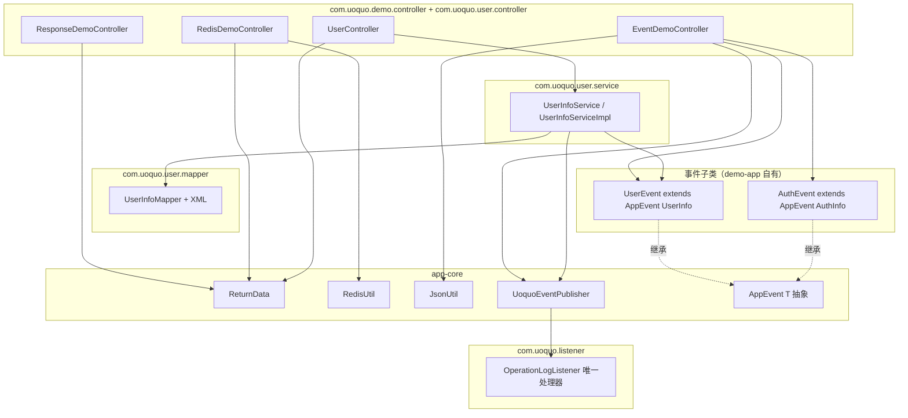
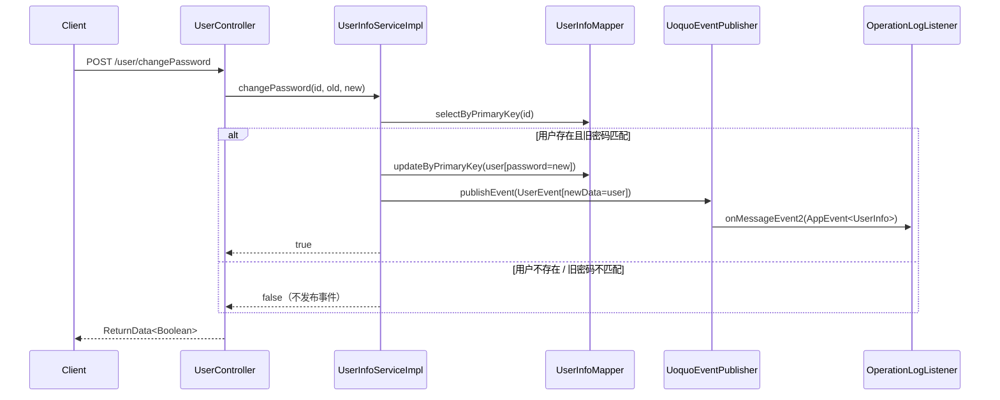
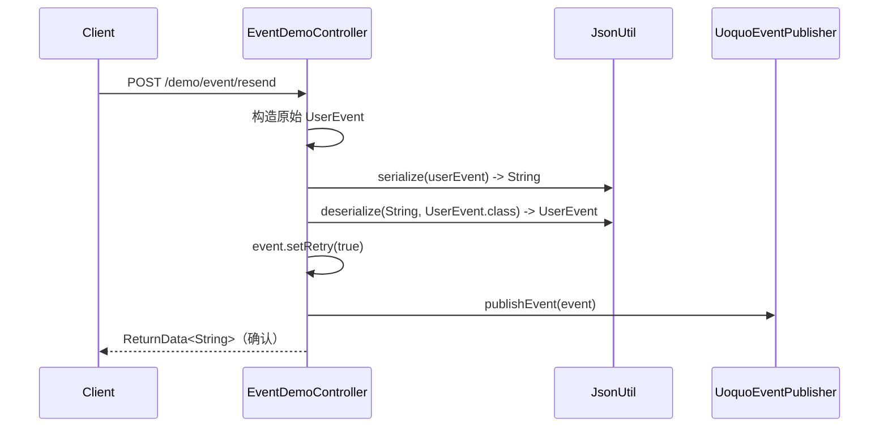

# Design Document

## Overview

本设计描述如何重写 demo-app 的 controller 层并精简 user 层，使其干净、可编译地演示 `app-core` 框架的四项能力：统一响应类型、Redis 工具、集中事件发布，以及事件的序列化重发。

设计严格遵循已核实的真实框架包名（见 requirements.md 的「已核实的技术上下文」），不再引用源码树中实际不存在的包（`com.uoquo.web.common.*`、`com.uoquo.web.handler.RedisUtil`、`com.uoquo.web.mybatis.page.*`、`com.uoquo.user.bean`、`com.uoquo.user.events.*`、`com.uoquo.cloud.events.*` 等）。

核心设计决策：

1. **以三个职责单一的 demo controller 替换现有损坏的 controller。** 现有的 `ExampleController`、`TestController`、`TestEventController`、`TestStoreController` 都引用了 demo-app 类路径上不存在的包，无法编译。它们将被三个新的、聚焦的 controller 替换：`ResponseDemoController`（返回类型演示）、`RedisDemoController`（Redis 操作）、`EventDemoController`（事件发布与重发）。
2. **所有事件发布统一经过 `UoquoEventPublisher`。** 移除 Spring `ApplicationEventPublisher` 的使用以及零散的 `@EventListener` 监听器，使 `OperationLogListener` 成为唯一的事件处理器。
3. **为 demo-app 定义自有的 `AuthInfo` POJO 与具体事件子类。** 由于 `AppEvent<T>` 是抽象类，且 demo-app 不依赖 demo-task、spring-cloud-bus，需在 demo-app 内定义 `AuthInfo`、具体事件 `UserEvent extends AppEvent<UserInfo>` 与 `AuthEvent extends AppEvent<AuthInfo>`。
4. **重发（resend）以单体等价方式实现。** 通过 `JsonUtil` 将 `UserEvent` 序列化为 String，再反序列化回 `UserEvent`，置 `retry=true` 后经 `UoquoEventPublisher` 在本地重新发布——不依赖 `StreamBridge`/`BusConstants`。

### 已核实的框架 API（来自源码树用法）

| 用途 | 真实类型 / 方法 | 证据来源 |
| --- | --- | --- |
| 响应包装 | `com.uoquo.web.ReturnData<T>`，构造 `new ReturnData<>(data)`，访问 `getData()` | 现有用法与 requirements 已核实上下文 |
| 免认证注解 | `com.uoquo.annotation.web.IgnoreAuth`，用法 `@IgnoreAuth(all = true)` | requirements 已核实上下文；现存 `@IgnoreAuth(all=true)` 用法 |
| Redis 工具 | `com.uoquo.utils.spring.RedisUtil`，静态方法 `put(key,value,expireSeconds)`、`get(key)` / `get(key, Class)`、`delete(key)`、`exists(key)` | `DeveloperConfig`、`ExampleController` 等用法 |
| 分页结果 | `com.uoquo.mybatis.page.PageList<T>` | requirements 已核实上下文 |
| 分页助手 | `com.uoquo.mybatis.page.PageHelper.startPage(page, pageSize)` | 现有 `UserInfoServiceImpl` 用法（包名修正） |
| JSON 工具 | `com.uoquo.utils.json.JsonUtil.serialize(obj)` / `deserialize(json, Class)` / `deserialize(json, Class, dataType)` | `JsonTest`、`OperationLogListener` 用法 |
| ID 生成 | `com.uoquo.utils.IDGenerator.getUUID()` / `getNextLong()` | `ExampleController` 用法 |
| 事件基类 | `com.uoquo.web.events.AppEvent<T>`（抽象），暴露 `businessType`、`operationType`、`operationStatus`、`oldData`、`newData`、`retry`、`id` | requirements 已核实上下文；`OperationLogListener`、`InnerEvent` |
| 事件发布器 | `com.uoquo.web.events.UoquoEventPublisher.publishEvent(Object)` | `OperationLogListener` 邻接用法、requirements 已核实上下文 |

## Architecture

demo-app 是一个 Spring Boot（Jakarta EE）单体应用。重写后的运行期结构如下：



事件流（修改密码与重发）：





### 包结构（重写后）

```
com.uoquo.demo.controller
  ├── ResponseDemoController      (新增)
  ├── RedisDemoController         (新增)
  └── EventDemoController         (新增)
com.uoquo.demo.model.pojo
  └── AuthInfo                    (新增，demo-app 自有)
com.uoquo.demo.event
  └── AuthEvent                   (新增，extends AppEvent<AuthInfo>)
com.uoquo.user.controller
  └── UserController              (重写，仅两个接口)
com.uoquo.user.service[.impl]
  └── UserInfoService / Impl      (精简为两个操作)
com.uoquo.user.mapper
  └── UserInfoMapper(.xml)        (精简)
com.uoquo.user.model.pojo
  └── UserInfo                    (保持不变)
com.uoquo.user.model.param
  └── ChangePasswordParam         (保持不变)
com.uoquo.user.event
  └── UserEvent                   (新增，extends AppEvent<UserInfo>)
com.uoquo.listener
  └── OperationLogListener        (保留，唯一处理器)
```

待移除（编译失败的废弃代码）：

- `com.uoquo.demo.controller.ExampleController`、`TestController`、`TestEventController`、`TestStoreController`
- `com.uoquo.demo.listener.ExampleEventListener`（整个包）
- `com.uoquo.user.listener.PasswordChangedEventListener`（整个包）
- `UserInfoServiceImpl.PasswordChangedEvent` 内部类

## Components and Interfaces

### UserController（`com.uoquo.user.controller.UserController`）

恰好两个接口，仅从真实包导入（`com.uoquo.web.ReturnData`、`com.uoquo.mybatis.page.PageList`），不再引用 `userName 之外的未定义变量`。

```java
@Tag(name = "user")
@RestController
@RequestMapping("/user")
@IgnoreAuth(all = true)            // 需求 12.2：demo 接口免认证
public class UserController {

    @Autowired
    private UserInfoService userInfoService;

    // 需求 1.2：分页查询，返回 ReturnData<PageList<UserInfo>>
    @GetMapping("/list")
    @Operation(description = "用户分页查询", operationId = "userList")
    public ReturnData<PageList<UserInfo>> list(
            @RequestParam(value = "userName", required = false) String userName,
            @RequestParam(value = "page", defaultValue = "1") int page,
            @RequestParam(value = "pageSize", defaultValue = "10") int pageSize) {
        Map<String, Object> params = new HashMap<>();
        if (userName != null && !userName.trim().isEmpty()) {
            params.put("userName", userName);
        }
        return new ReturnData<>(userInfoService.getListByPage(params, page, pageSize));
    }

    // 需求 1.3：修改密码，返回 ReturnData<Boolean>
    @PostMapping("/changePassword")
    @Operation(description = "修改密码", operationId = "changePassword")
    public ReturnData<Boolean> changePassword(@Valid @RequestBody ChangePasswordParam param) {
        boolean ok = userInfoService.changePassword(
                param.getId(), param.getOldPassword(), param.getNewPassword());
        return new ReturnData<>(ok);
    }
}
```

设计说明：保留 `userName` 作为可选查询条件以匹配 mapper 的 `selectBySearch`；移除已删除的 `getUserById` 接口（需求 1.1 要求恰好两个接口）。

### UserInfoService（`com.uoquo.user.service.UserInfoService`）

恰好两个操作（需求 2.1）：

```java
public interface UserInfoService {
    // 需求 2.2
    PageList<UserInfo> getListByPage(Map<String, Object> map, int page, int pageSize);
    // 需求 2.3–2.5、4.x
    boolean changePassword(String id, String oldPassword, String newPassword);
}
```

实现要点（`UserInfoServiceImpl`）：

```java
@Service
public class UserInfoServiceImpl implements UserInfoService {

    @Autowired
    private UserInfoMapper userInfoMapper;

    // 需求 10.1：以框架发布器注入（替换 ApplicationEventPublisher）
    @Autowired
    private UoquoEventPublisher eventPublisher;

    @Override
    public PageList<UserInfo> getListByPage(Map<String, Object> map, int page, int pageSize) {
        PageHelper.startPage(page, pageSize);                      // 需求 2.2
        return (PageList<UserInfo>) userInfoMapper.selectBySearch(map);
    }

    @Override
    @Transactional
    public boolean changePassword(String id, String oldPassword, String newPassword) {
        UserInfo user = userInfoMapper.selectByPrimaryKey(id);
        if (user == null) {
            return false;                                          // 需求 2.4
        }
        if (oldPassword == null || !oldPassword.equals(user.getPassword())) {
            return false;                                          // 需求 2.5
        }
        user.setPassword(newPassword);
        int rows = userInfoMapper.updateByPrimaryKey(user);
        if (rows > 0) {
            UserEvent event = new UserEvent("USER", "CHANGE_PASSWORD", "SUCCESS");
            event.setNewData(user);                                // 需求 4.3
            eventPublisher.publishEvent(event);                    // 需求 4.1
            return true;                                           // 需求 2.3
        }
        return false;                                              // 需求 4.5：未成功则不发布
    }
}
```

设计说明：`PageHelper.startPage` 拦截下一条 mapper 查询并返回 `PageList`；`selectBySearch` 返回的 `List<UserInfo>` 在分页拦截后实际为 `PageList<UserInfo>`，沿用现有代码的强制转换约定。

### UserInfoMapper（`com.uoquo.user.mapper.UserInfoMapper`）

仅声明两个 service 操作所需的方法（需求 3.1），使用真实包 `com.uoquo.user.model.pojo.UserInfo`（需求 3.2），不引用 `com.uoquo.user.bean` 或 `com.uoquo.web.mybatis.sensitive.SensitiveField`（需求 3.4）。

```java
package com.uoquo.user.mapper;

import com.uoquo.user.model.pojo.UserInfo;
import java.util.List;
import java.util.Map;

public interface UserInfoMapper {
    List<UserInfo> selectBySearch(Map<String, Object> map);   // 分页查询用
    UserInfo selectByPrimaryKey(String id);                    // 修改密码：读取
    int updateByPrimaryKey(UserInfo row);                      // 修改密码：更新
}
```

XML（`UserInfoMapper.xml`）：`resultMap` 与参数类型改为 `com.uoquo.user.model.pojo.UserInfo`；`resultMap` 仅映射 `UserInfo` POJO 上真实存在的列（需求 3.3）：`id`、`user_name`、`real_name`、`phone`、`password`、`email`、`create_time`。仅保留 `selectBySearch`、`selectByPrimaryKey`、`updateByPrimaryKey` 三段，删除其余引用不存在列/类型的语句。

```xml
<resultMap id="BaseResultMap" type="com.uoquo.user.model.pojo.UserInfo">
  <id     column="id"          property="id"/>
  <result column="user_name"   property="userName"/>
  <result column="real_name"   property="realName"/>
  <result column="phone"       property="phone"/>
  <result column="password"    property="password"/>
  <result column="email"       property="email"/>
  <result column="create_time" property="createTime"/>
</resultMap>
```

### ResponseDemoController（`com.uoquo.demo.controller.ResponseDemoController`）

为每种被演示的返回类型暴露一个接口（需求 5.1–5.7），全部 `@IgnoreAuth(all = true)`：

| 接口 | 返回类型 | 需求 |
| --- | --- | --- |
| `GET /demo/response/string` | `ReturnData<String>` | 5.1 |
| `GET /demo/response/int` | `ReturnData<Integer>` | 5.2 |
| `GET /demo/response/long` | `ReturnData<Long>` | 5.3 |
| `GET /demo/response/double` | `ReturnData<Double>` | 5.4 |
| `GET /demo/response/boolean` | `ReturnData<Boolean>` | 5.5 |
| `GET /demo/response/map` | `ReturnData<Map<String, Object>>` | 5.6 |
| `GET /demo/response/user` | `ReturnData<UserInfo>` | 5.7 |

每个方法返回一个包装了相应类型示例值的 `ReturnData`。

### RedisDemoController（`com.uoquo.demo.controller.RedisDemoController`）

通过 `RedisUtil` 暴露基础操作（需求 6），全部 `@IgnoreAuth(all = true)`：

| 接口 | 行为 | 返回 | 需求 |
| --- | --- | --- | --- |
| `POST /demo/redis/set` (key, value) | `RedisUtil.put(key, value, ttl)` | `ReturnData<Boolean>` | 6.1 |
| `GET /demo/redis/get` (key) | `RedisUtil.get(key)` | `ReturnData<String>` | 6.2 |
| `DELETE /demo/redis/delete` (key) | `RedisUtil.delete(key)` | `ReturnData<Boolean>` | 6.3 |
| `GET /demo/redis/exists` (key) | `RedisUtil.exists(key)` | `ReturnData<Boolean>` | 6.4 |

异常处理（需求 6.5、6.6）采用嵌套 try-catch：

```java
@PostMapping("/set")
@IgnoreAuth(all = true)
public ReturnData<Boolean> set(@RequestParam String key, @RequestParam String value) {
    try {
        RedisUtil.put(key, value, 300);
        return new ReturnData<>(true);
    } catch (Exception e) {
        try {
            log.error("Redis set 失败, key={}", key, e);   // 需求 6.5：记录异常
        } catch (Exception ignore) {
            // 需求 6.6：记录本身失败也吞掉，仍返回 false
        }
        return new ReturnData<>(false);
    }
}
```

### EventDemoController（`com.uoquo.demo.controller.EventDemoController`）

集中处理事件发布与重发（需求 7、8、9），以 `private UoquoEventPublisher eventPublisher;` 注入（需求 10.2），全部 `@IgnoreAuth(all = true)`：

| 接口 | 行为 | 需求 |
| --- | --- | --- |
| `POST /demo/event/login-success` | 发布 `AuthEvent`(AUTH/LOGIN/成功状态)，newData=AuthInfo(account) | 7 |
| `POST /demo/event/login-failure` | 发布 `AuthEvent`(AUTH/LOGIN/失败状态)，newData=AuthInfo(account) | 8 |
| `POST /demo/event/resend` | 序列化→反序列化 `UserEvent`，置 retry=true，重新发布 | 9 |

```java
// 需求 7
@PostMapping("/login-success")
@IgnoreAuth(all = true)
public ReturnData<String> loginSuccess(@RequestParam String account) {
    try {
        AuthEvent event = new AuthEvent("AUTH", "LOGIN", "SUCCESS");  // 7.3
        AuthInfo info = new AuthInfo();
        info.setAccount(account);
        event.setNewData(info);                                       // 7.4
        eventPublisher.publishEvent(event);                           // 7.1
    } catch (Exception e) {
        log.error("发布登录成功事件失败", e);                          // 7.6：仍返回确认
    }
    return new ReturnData<>("login-success event published");         // 7.5
}

// 需求 9：序列化 + 重发
@PostMapping("/resend")
@IgnoreAuth(all = true)
public ReturnData<String> resend() {
    UserEvent original = buildSampleUserEvent();
    String json = JsonUtil.serialize(original);                       // 9.1
    UserEvent restored = JsonUtil.deserialize(json, UserEvent.class); // 9.2
    restored.setRetry(true);                                          // 9.3
    eventPublisher.publishEvent(restored);                            // 9.4
    return new ReturnData<>("resend event published");                // 9.6
}
```

设计说明（重发与认证状态）：

- 失败状态（需求 8.2）使用字符串常量 `"FAIL"`；成功状态（7.3）使用 `"SUCCESS"`。这些是约定的演示常量。
- 登录失败发布失败时（需求 8.5）只 catch 并返回确认，**不重试**——区别于需求 9 的显式重发。

## Data Models

### AuthInfo（`com.uoquo.demo.model.pojo.AuthInfo`，新增）

demo-app 自有的认证数据 POJO（需求 12.3），字段与 demo-task 的同名类对齐但独立定义，含无参构造函数（供 JSON 反序列化）：

```java
public class AuthInfo {
    private String account;
    private String password;     // 仅认证失败时记录
    private String deviceInfo;
    private String deviceOs;
    private String deviceUa;
    public AuthInfo() {}
    // getters / setters ...
}
```

### UserInfo（`com.uoquo.user.model.pojo.UserInfo`，保持不变）

字段：`id`、`userName`、`realName`、`phone`、`password`、`email`、`createTime`。`realName`/`phone`/`email` 带 `@SensitiveField`（`com.uoquo.mybatis.sensitive`）。

### UserEvent（`com.uoquo.user.event.UserEvent extends AppEvent<UserInfo>`，新增）

`AppEvent<T>` 是抽象类，必须提供具体子类（需求 4.2）。仿照 `InnerEvent` 的构造模式，并提供无参构造函数以支持 JSON 往返（需求 9）：

```java
public class UserEvent extends AppEvent<UserInfo> {
    public UserEvent() { super(); }
    public UserEvent(String businessType, String operationType, String operationStatus) {
        super(businessType, operationType, operationStatus);
    }
}
```

### AuthEvent（`com.uoquo.demo.event.AuthEvent extends AppEvent<AuthInfo>`，新增）

参数化为 `AppEvent<AuthInfo>`（需求 7.2）：

```java
public class AuthEvent extends AppEvent<AuthInfo> {
    public AuthEvent() { super(); }
    public AuthEvent(String businessType, String operationType, String operationStatus) {
        super(businessType, operationType, operationStatus);
    }
}
```

### 事件序列化模型（需求 9）

`AppEvent` 继承体系携带 Jackson 多态类型信息（`JsonTypeInfo`，证据见 `JsonTest` 注释「父类有 JsonTypeInfo 的注解」）。设计据此约束：

- `UserEvent` 提供**无参构造函数**，以便 `JsonUtil.deserialize` 重建实例。
- 反序列化使用具体类型 `JsonUtil.deserialize(json, UserEvent.class)`；若泛型 `newData` 需要显式数据类型，则使用三参重载 `JsonUtil.deserialize(json, UserEvent.class, UserInfo.class)`（参照 `JsonTest` 的 `deserialize(json, RemoteEvent.class, AuthInfo.class)` 用法）。
- 往返需保持 `businessType`、`operationType`、`operationStatus`、`newData` 相等（需求 9.5）。

## Correctness Properties

*属性（property）是指在系统所有有效执行中都应当成立的特征或行为——本质上是对系统应当做什么的形式化陈述。属性是连接人类可读规格与机器可验证正确性保证之间的桥梁。*

下列属性依据验收标准 prework 分析得出。每个属性均为全称量化陈述，将由属性测试覆盖；其余验收标准以单元测试、集成测试或冒烟/编译检查覆盖（见 Testing Strategy）。

### Property 1: 修改密码校验逻辑

*For any* UserInfo 记录与任意 oldPassword 字符串，`changePassword(id, oldPassword, newPassword)` 当且仅当该 id 能解析到存储记录、且 oldPassword 等于存储密码时返回 true 并将存储密码更新为 newPassword；在其余情况下返回 false 且不发生任何密码更新。

**Validates: Requirements 2.3, 2.4, 2.5**

### Property 2: 修改密码成功才发布携带更新数据的 User_Event

*For any* UserInfo 记录与任意 oldPassword 字符串，当 `changePassword` 成功（返回 true）时，恰好通过 `UoquoEventPublisher` 发布一个 `UserEvent`，且该事件的 newData 等于更新后的 UserInfo 记录；当 `changePassword` 失败（返回 false）时，不发布任何事件。

**Validates: Requirements 4.1, 4.3, 4.5**

### Property 3: 认证模拟事件携带所模拟账号

*For any* account 字符串，登录成功模拟与登录失败模拟所发布的 `AuthEvent` 的 newData 都是一个 AuthInfo，其 account 字段等于输入的 account。

**Validates: Requirements 7.4, 8.3**

### Property 4: User_Event 序列化往返

*For any* `UserEvent`（携带任意 businessType、operationType、operationStatus 与任意 UserInfo newData），通过 `JsonUtil` 序列化为 String 再反序列化回 `UserEvent` 后，所得事件的 businessType、operationType、operationStatus 与 newData 都与原始事件相等。

**Validates: Requirements 9.1, 9.2, 9.5**

### Property 5: Redis 存取往返

*For any* 非空 key 与任意 value 字符串，经 `RedisDemoController` 将 value 存入 key 后，在过期前通过该 controller 重新读取该 key 应返回所存储的 value。

**Validates: Requirements 6.7**

## Error Handling

| 场景 | 处理策略 | 需求 |
| --- | --- | --- |
| changePassword：用户不存在 | 返回 false，不更新、不发布事件 | 2.4, 4.5 |
| changePassword：旧密码不匹配 | 返回 false，不更新、不发布事件 | 2.5, 4.5 |
| Redis 操作抛异常 | catch 并记录日志，返回 `ReturnData<>(false)` | 6.5 |
| Redis 异常且日志记录本身失败 | 内层 catch 吞掉日志异常，仍返回 `ReturnData<>(false)` | 6.6 |
| 登录成功模拟：发布失败 | catch 并记录，仍返回确认 String | 7.6 |
| 登录失败模拟：发布失败 | catch 并记录，仍返回确认 String，且不重试发布 | 8.5 |
| 请求体校验失败（ChangePasswordParam） | 由框架 `@Valid` 与全局异常处理统一返回错误 ReturnData | 1.3 |

设计原则：

- demo controller 面向演示，遵循「永不让异常逃逸为 5xx」的约定——Redis 与事件接口在异常时返回稳定的 `ReturnData`（布尔 false 或确认字符串）。
- 事件发布异常被隔离在 controller/service 边界，不影响主响应（修改密码的事件发布异常不在需求范围内强制回滚事务；事件发布位于更新成功之后）。

## Testing Strategy

### 测试分层

- **属性测试（Property tests）**：覆盖上述 5 个 Correctness Properties，验证跨大量输入的普遍正确性。
- **单元测试（Unit/Example tests）**：覆盖固定返回类型接口（需求 5.1–5.7、7.1–7.3/7.5、8.1/8.2/8.4、9.3/9.4/9.6、4.2、7.2、1.3 委托）与边界/错误条件（需求 6.5、6.6、7.6、8.5）。
- **集成测试（Integration tests）**：覆盖依赖外部服务/框架装配的标准（需求 1.2、2.2 分页；6.1–6.4 Redis 委托；4.4 监听器分发）。建议 1–3 个代表性示例。
- **冒烟/编译检查（Smoke）**：覆盖结构与编译约束（需求 1.1、1.4、1.5、2.1、3.1–3.4、10.1–10.3、11.1–11.4、12.1–12.3）。通过 `mvn -pl demo-app compile`、反射检查与源码静态检查完成。

### 属性测试库

- 目标语言为 Java，选用 **jqwik**（`net.jqwik:jqwik`，JUnit 5 平台）作为属性测试库。不自行实现属性测试框架。
- 需在 demo-app 的 `pom.xml` 中以 `test` scope 引入 jqwik。
- 纯逻辑属性（Property 1–4）使用 mock（Mockito）隔离 mapper 与 publisher，使每次迭代低成本。Property 5（Redis 往返）使用内嵌/测试用 Redis（如 embedded-redis 或 Testcontainers），或在不可用时降级为对 `RedisUtil` 的内存级 fake。

### 属性测试配置

- 每个属性测试至少运行 **100 次迭代**（jqwik `@Property(tries = 100)` 或更高）。
- 每个属性测试以注释标注其对应的设计属性，格式：
  `// Feature: app-core-demo-controllers, Property {number}: {property_text}`
- 每个 Correctness Property 用**单个**属性测试实现。

### 生成器要点

- **UserInfo 生成器**：随机 id、userName、realName、phone、password、email、createTime；password 覆盖空串、含特殊字符与中文。
- **oldPassword 生成器**：以一定概率生成与存储密码相等的值，以保证 true/false 两条路径都被充分采样（Property 1、2）。
- **account 生成器**：覆盖空串、ASCII、非 ASCII（Property 3）。
- **UserEvent 生成器**：随机 businessType/operationType/operationStatus 字符串 + 随机 UserInfo newData（Property 4）。
- **key/value 生成器**：非空 key（避免与其他用例冲突，建议加随机前缀）与任意 value（Property 5）。

### 单元测试节制

- 返回类型接口（需求 5）以少量示例断言类型与示例值，不为每种类型堆叠冗余用例。
- 错误条件（6.5、6.6、7.6、8.5）各 1 个针对性示例，通过 mock 强制抛异常。

### 验收标准到测试类型映射（汇总）

| 需求 | 测试类型 |
| --- | --- |
| 2.3, 2.4, 2.5 | Property 1 |
| 4.1, 4.3, 4.5 | Property 2 |
| 7.4, 8.3 | Property 3 |
| 9.1, 9.2, 9.5 | Property 4 |
| 6.7 | Property 5 |
| 1.2, 2.2, 4.4, 6.1–6.4 | 集成测试 |
| 1.3, 4.2, 5.1–5.7, 7.1–7.3, 7.5, 8.1, 8.2, 8.4, 9.3, 9.4, 9.6 | 单元/示例测试 |
| 6.5, 6.6, 7.6, 8.5 | 边界/错误单元测试 |
| 1.1, 1.4, 1.5, 2.1, 3.1–3.4, 10.1–10.3, 11.1–11.4, 12.1–12.3 | 冒烟/编译/静态检查 |
